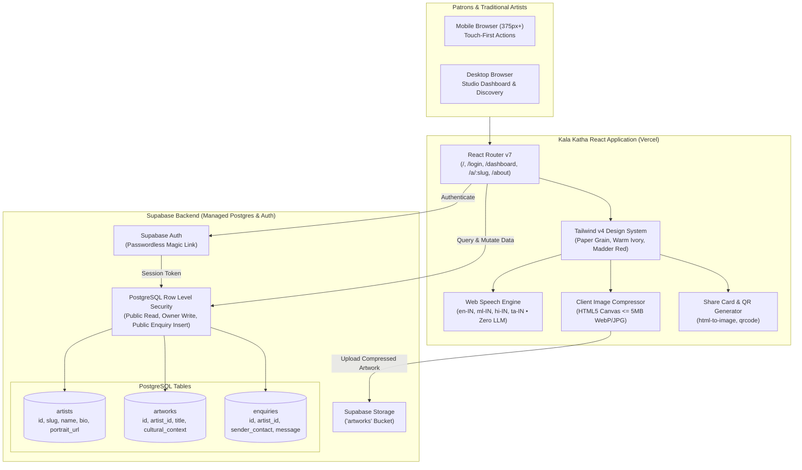

# Kala Katha — From Craft to Click

A mobile-first, lightweight web application empowering traditional Indian folk, tribal, and classical artisans to build professional digital portfolios, preserve the living cultural context behind their work, and connect directly with global art patrons.

Built for the **ART//CODE Hackathon** | Problem Statement: *"From Craft to Click – Artist Visibility"*.

---

## 1. Project Overview

**Kala Katha** (working title, centrally configurable for easy renaming) is a dignified digital platform created for grassroots Indian craftspeople—masters of Madhubani, Warli, Kerala Mural, Pattachitra, Gond, Kalamkari, Tanjore, and other generational craft traditions.

Unlike conventional e-commerce marketplaces that strip away cultural significance and turn sacred art into commercial commodities, Kala Katha ensures that **cultural context travels with every share**. It provides voice-driven onboarding in regional languages, client-side image compression for low-bandwidth rural connections, downloadable mounted-print share cards, multilingual social caption templates, printable exhibition stall QR codes, and direct buyer/commission enquiries with zero middlemen or commission fees.

Strict quality standard: **Zero fake or hardcoded data**. All artists, artworks, cultural narratives, and enquiries are rendered dynamically from real Supabase Postgres records with dignified empty states.

---

## 2. Problem Statement

Traditional Indian artists face severe structural barriers in the modern digital economy:
1. **The Digital Literacy Divide**: Many artisans are fluent in regional languages (Malayalam, Hindi, Tamil, etc.) but find typing marketing copy in English prohibitive.
2. **Loss of Cultural Context**: When photos of sacred paintings or tribal crafts are circulated online, the lineage, natural mineral dyes, guru-shishya heritage, and ritual symbolism are lost.
3. **Exploitative Intermediaries**: Commercial marketplaces take heavy margins (up to 40-50%) and obscure the artist's contact details, preventing long-term patronage.
4. **Bandwidth & Device Constraints**: High-resolution mobile camera photos fail to upload over 3G/4G connections without proper client-side image optimization.

**Kala Katha solves this** by making the creation of a professional online identity as simple as speaking into a phone microphone, generating beautiful shareable cards with cultural stories embedded, and enabling direct peer-to-peer patronage.

---

## 3. Key Features

1. **Artist Onboarding & Profile**:
   - Barrier-free, passwordless login via Supabase Email Magic Links.
   - Dual-script support: artist name in Latin script and optional mother-tongue script (`name_regional`, e.g., in Malayalam, Devanagari, or Tamil).
   - Profile with art form, Indian state/district, biography, languages spoken, portrait upload, and direct WhatsApp/phone contact channels.
   - Automatic unique slug generation (e.g. `/a/narayan-marar-kerala-mural`).

2. **Artwork Gallery Manager**:
   - Fast client-side image compression (`<= 5MB`, HTML5 Canvas WebP/JPEG) optimized for mobile connections.
   - Core fields: Title, regional title, medium/materials, year, dimensions, price (or "Price on Request" toggle), availability status (`available`, `reserved`, `sold`, `archived`).
   - First-class **Cultural Context / Story** narrative field.
   - Mandatory ethical declaration checkbox: *"This work is mine, or I have the artist's permission to share it."*
   - Responsive grid, lightbox view, edit, and delete for the authenticated artist.

3. **Shareable Artwork Card**:
   - Designed mounted-print card featuring artwork image, title, artist name, location, art form, cultural context snippet, and portfolio URL.
   - **Download as Image**: Exports crisp 2x resolution PNG using `html-to-image`.
   - **Share via WhatsApp**: Direct `wa.me` link pre-filled with formatted title, artist, story snippet, and URL.
   - **Copy Link & Native Share Sheet**: Full clipboard and Web Share API support.
   - Dynamic Open Graph meta tags (`og:title`, `og:description`, `og:image`, `og:url`) for rich social link previews.

4. **Multilingual Social Media Caption Templates**:
   - Generates social captions in **Malayalam (Default)**, **English**, **Hindi**, and **Tamil**.
   - 3 Curated Tones:
     - *Story*: Focuses on lineage, sacred symbols, and natural mineral dyes.
     - *Announcement*: Studio update announcing a newly completed piece.
     - *Commission Open*: Invites custom orders and workshops.
   - Live editable textarea preview + one-click copy button.
   - Visible native-speaker review recommendation notice.

5. **Direct Patron Enquiry / Commission Form**:
   - Embedded on all artist profiles and artwork detail pages.
   - Fields: Name, contact (email or phone), message, enquiry type (*Buy / Commission / Collaboration / Workshop*), optional budget.
   - **Honeypot Spam Defense**: Invisible honeypot field that drops bot spam without affecting real patrons.
   - Private Artist Dashboard Inbox: Received enquiries with read/unread status toggle, 1-click **WhatsApp Reply** and **Email Reply** shortcuts.

6. **Public Portfolio & Printable QR Code**:
   - Public page at `/a/:slug` with mobile-first responsive layout (375px+).
   - Sticky bottom mobile action bar (`[Enquire / Buy]` & `[Share Portfolio]`).
   - High-contrast downloadable QR code (PNG, via `qrcode`) with the artist's name and art form branded beneath it for exhibition stalls and visiting cards.

7. **UNIQUE FEATURE — Voice "Tell Your Story"**:
   - Native Web Speech API integration (`SpeechRecognition` / `webkitSpeechRecognition`) with **zero paid APIs and zero LLM calls**.
   - Regional speech recognition language selector (`ml-IN`, `en-IN`, `hi-IN`, `ta-IN`).
   - 3 Guided Storytelling Prompts for artworks:
     - *(a) "What is this artwork and what does it show?"*
     - *(b) "Who taught you, and how is it made?"*
     - *(c) "What does it mean in your tradition?"*
   - Real-time listening pulse state, permission denial handler, browser compatibility warnings, and continuous keyboard editing fallback.

8. **Discovery & Multi-Parameter Search Engine**:
   - Home page lists all registered artists dynamically from Supabase Postgres.
   - Multi-parameter live search: free-text keyword search across names, regional scripts, crafts, locations, and bios.
   - Reactive filters: Art Form, Indian State, and Spoken Language.
   - Authentic empty states when no records or no search matches exist.

---

## 4. Technology Stack

- **Frontend Framework**: React 19 + TypeScript + Vite 8
- **Routing**: React Router 7 (`react-router-dom`)
- **Styling & Design System**: Tailwind CSS v4 (`@tailwindcss/vite`) with custom Indian heritage tokens:
  - *Paper Cream* (`#F6EEDC`), *Warm Ivory* (`#FBF6EA`), *Indigo Ink* (`#1F2A44`), *Madder Red* (`#A63D2F`), *Turmeric* (`#E0A526`), *Terracotta* (`#C8683F`), *Leaf Green* (`#4F6B3A`), *Charcoal* (`#2B2622`).
- **Typography (Google Fonts / OFL)**:
  - Headings: *Fraunces*
  - Body: *Mukta*
  - Malayalam: *Noto Serif Malayalam* & *Noto Sans Malayalam*
  - Devanagari & Tamil: *Noto Sans Devanagari* & *Noto Sans Tamil*
- **Backend & Database**: Supabase (PostgreSQL with Row Level Security, Supabase Auth via Email Magic Links, Supabase Storage)
- **Client Utilities**:
  - `qrcode`: Client-side QR generation for physical craft stalls.
  - `html-to-image`: Client-side rendering of shareable artwork cards to high-resolution PNG.
  - `lucide-react`: Lightweight, accessible icon set.
  - HTML5 Canvas: Client-side image compression (`<= 5MB`, WebP/JPEG).
  - Web Speech API: Native voice-to-text input with regional locale support.
- **Unit Testing**: Vitest 5
- **Deployment**: Vercel (configured with `vercel.json` SPA routing rewrites)

---

## 5. System Architecture



---

## 6. Installation & Setup Instructions

### Prerequisites
- Node.js (v18.0.0 or later; v24 LTS recommended)
- npm (v9.0.0 or later)
- A free Supabase account ([supabase.com](https://supabase.com))

### Local Setup
1. **Clone the repository**:
   ```bash
   git clone https://github.com/your-username/artcode.git
   cd artcode
   ```

2. **Install project dependencies**:
   ```bash
   npm install
   ```

3. **Configure Environment Variables**:
   Copy `.env.example` to `.env`:
   ```bash
   cp .env.example .env
   ```
   Add your Supabase project credentials (see Section 7).

4. **Initialize Supabase Database & Storage**:
   - Open your project in the [Supabase Dashboard](https://app.supabase.com).
   - Navigate to the **SQL Editor** tab.
   - Copy the entire contents of `supabase/schema.sql` and run it.
   - This creates tables (`artists`, `artworks`, `enquiries`), performance indexes, Row Level Security policies, and the `artworks` storage bucket.

5. **Run the Development Server**:
   ```bash
   npm run dev
   ```
   Open `http://localhost:5173` in your browser.

6. **Run Unit Tests**:
   ```bash
   npm test
   ```

7. **Production Build**:
   ```bash
   npm run build
   ```

---

## 7. Environment Variables

Create a `.env` file in the project root based on `.env.example`:

```env
# Supabase Project URL (Dashboard > Settings > API > Project URL)
VITE_SUPABASE_URL=https://your-project-id.supabase.co

# Supabase Anon Public Key (Dashboard > Settings > API > Project API keys > anon public)
VITE_SUPABASE_ANON_KEY=eyJhbGciOiJIUzI1NiIsInR5cCI6IkpXVCJ9...
```

> [!CAUTION]
> **Security Notice**: Never commit `.env` or expose the `service_role` secret key! Only use `VITE_SUPABASE_ANON_KEY` on the client.

---

## 8. Usage Instructions

### For Traditional Artists
1. **Sign In**: Navigate to `/login`, enter your email, and click the magic link sent to your inbox.
2. **Setup Profile**: In the **Profile & Biography** tab, enter your name, regional script name, art form, location, and bio. Use the **Voice "Tell Your Story"** microphone button to speak your bio in Malayalam, Hindi, Tamil, or English. Upload a portrait and add your WhatsApp contact number.
3. **Upload Artwork**: Switch to the **Artworks Gallery** tab and click **Add Artwork**. Choose an image (auto-compressed), enter dimensions/medium, and use the guided voice prompts to record the cultural story. Tick the ethical ownership declaration and save.
4. **Share**: View your public portfolio at `/a/:slug`. Tap **Share Card** to download an image for Instagram, or **Share & QR Code** to download a printable stall QR code.
5. **Manage Enquiries**: Check the **Enquiries & Commissions** tab to review messages from art patrons with 1-click WhatsApp and email reply shortcuts.

### For Art Patrons & Collectors
1. **Explore**: Browse living craft traditions on the Home page (`/`) using search keywords or filtering by Art Form, Indian State, or Language.
2. **Read the Story**: Click any artist or artwork to view full-resolution pieces and understand their sacred origin.
3. **Direct Contact**: Click **Enquire / Buy** or **WhatsApp Artist** to negotiate custom commissions or acquire artworks directly without platform fees.

---

## 9. Demonstration Screenshots

Place demonstration screenshots in the `docs/screenshots/` directory:

| Feature | Screenshot Path | Description |
|---|---|---|
| **Discovery & Home Page** | `docs/screenshots/01_home_discovery.png` | Heritage hero section with live multi-parameter search & filters |
| **Artist Studio Onboarding** | `docs/screenshots/02_artist_studio_onboarding.png` | Artist profile editor with voice biography recording |
| **Artwork Upload & Story** | `docs/screenshots/03_artwork_upload_story.png` | Artwork upload with guided voice storytelling prompts & ethical declaration |
| **Public Artist Portfolio** | `docs/screenshots/04_public_portfolio.png` | Mobile-first public portfolio page at `/a/:slug` with artwork grid |
| **Artwork Lightbox View** | `docs/screenshots/05_artwork_lightbox_narrative.png` | Uncropped artwork display with full cultural context narrative |
| **Shareable Artwork Card** | `docs/screenshots/06_shareable_card_export.png` | Designed mounted-print card with 2x PNG export & WhatsApp share |
| **Multilingual Captions** | `docs/screenshots/07_multilingual_captions.png` | Caption generator with Malayalam, English, Hindi, and Tamil tones |
| **Stall QR Code Panel** | `docs/screenshots/08_qr_code_display.png` | Printable branded QR code with artist name and art form |
| **Patron Enquiry Modal** | `docs/screenshots/09_enquiry_modal.png` | Commission form with honeypot bot spam defense |
| **Artist Private Inbox** | `docs/screenshots/10_artist_enquiries_inbox.png` | Received enquiries dashboard with WhatsApp and email reply shortcuts |

---

## 10. Team Members

*(Fill in during submission)*
- **Builder / Designer**: Solo Builder
- **Role**: Full-Stack Engineer & Designer
- **Hackathon Track**: ART//CODE Hackathon — *"From Craft to Click – Artist Visibility"*

---

## 11. Limitations & Future Scope

### Current Limitations
1. **Voice Input Browser Support**: The Web Speech API is supported natively on Google Chrome, Microsoft Edge, Chromium-based browsers, and Android Chrome. Apple Safari and desktop Firefox have limited or vendor-flagged support. The app detects this gracefully and provides instant keyboard typing fallback.
2. **Regional Template Review**: While caption templates have been crafted in authentic Malayalam, Hindi, and Tamil, regional variations and dialects exist across states. Captions include a visible notice advising artists to review text before publishing; formal native-speaker linguistic validation is recommended as new art forms join.
3. **No In-App Payment Gateway**: To preserve 100% fair trade and eliminate transaction commissions, payments and shipping are coordinated directly between patron and artist via WhatsApp and email.
4. **No Automated Content Moderation**: Platform integrity currently relies on the mandatory ethical declaration checkbox. Large-scale public rollouts will benefit from community reporting and artisanal guild verification.

### Future Scope
- **Progressive Web App (PWA) Offline Mode**: Allow artists in remote craft clusters to draft artworks offline and synchronize automatically when connectivity is restored.
- **Master Artisan Verification**: Partner with governmental craft boards (e.g., Development Commissioner for Handicrafts, TRIFED) to provide digital authenticity seals.
- **Escrow-Based Milestone Payments**: Introduce optional UPI-based milestone escrow for high-value commission orders.
- **Audio Storytelling Playback**: Allow patrons to listen directly to the artist's spoken voice narrative while admiring the artwork.

---

## 12. License & Attribution

- **License**: Released under the open-source [MIT License](LICENSE).
- **Fonts & Typography**: Licensed under the [SIL Open Font License](CREDITS.md) (Google Fonts: *Fraunces*, *Mukta*, *Noto Serif Malayalam*, *Noto Sans Malayalam*, *Noto Sans Devanagari*, *Noto Sans Tamil*).
- **Cultural Attribution**: Traditional art styles, motifs, and sacred geometries belong immutably to the hereditary and indigenous communities of India.
